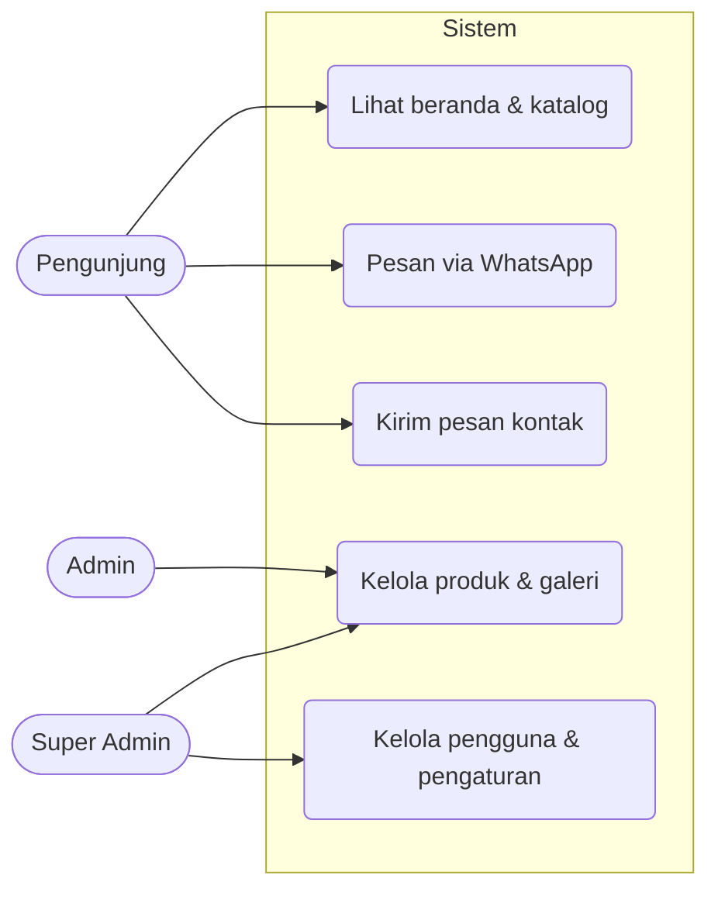
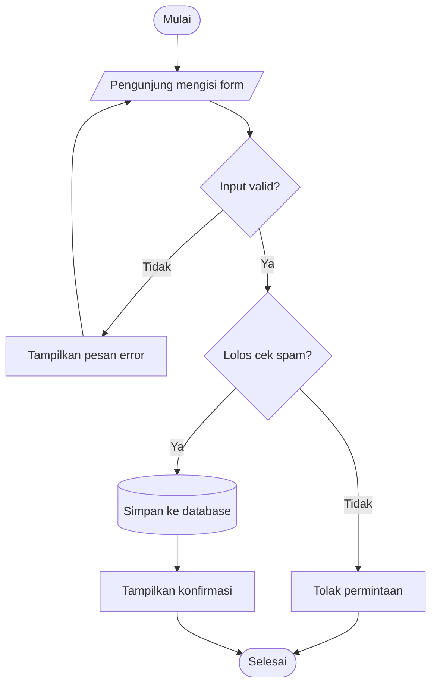
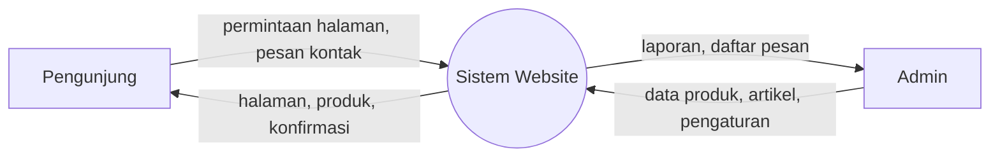
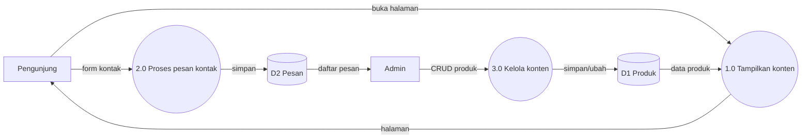
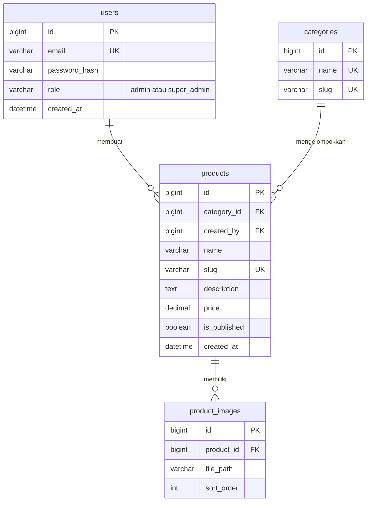
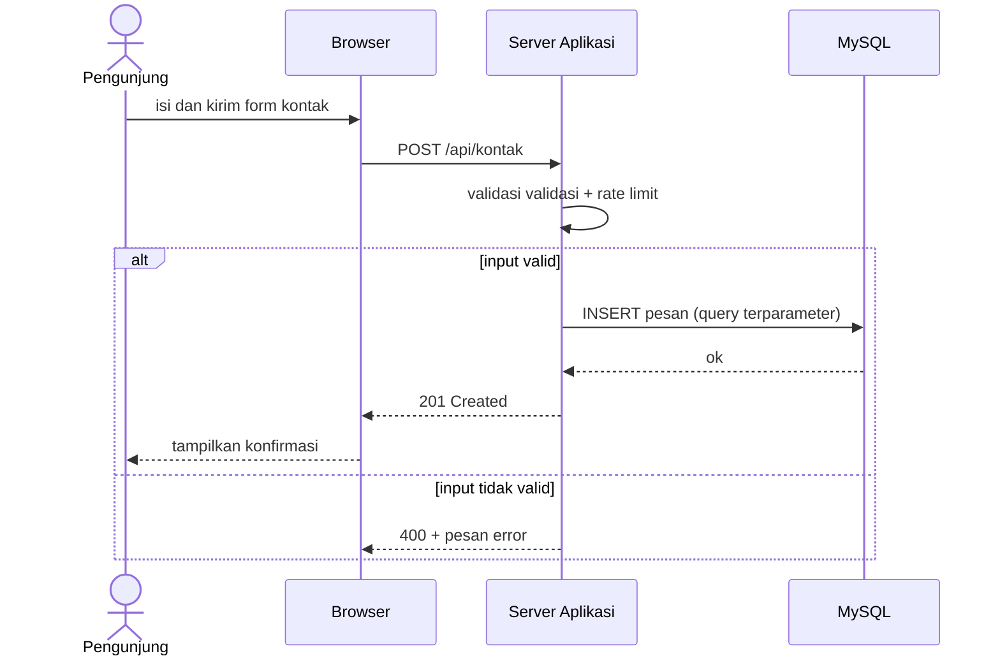
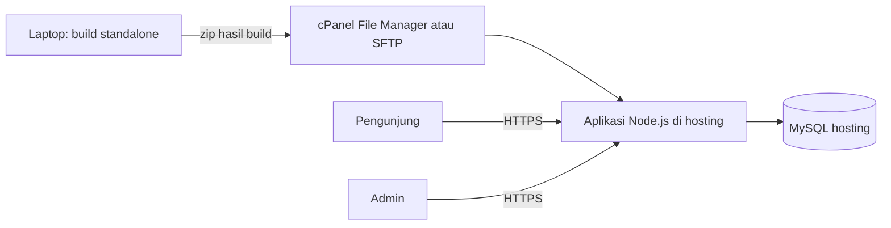
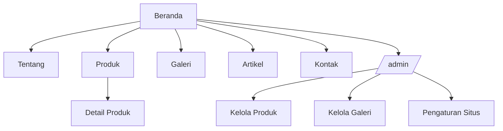

# Template Mermaid (salin lalu sesuaikan)

Semua blok di bawah dirender di GitHub dan VSCode (ekstensi Markdown Preview Mermaid Support). Ganti nama sesuai proyek. Jaga label singkat; karakter khusus (`/`, `(`, `)`, `&`) di dalam label sebaiknya dibungkus tanda kutip.

## 1. Use Case (dengan flowchart, karena Mermaid tidak punya diagram UML use case)

## 2. Flowchart / Activity

## 3. DFD Level 0 (Diagram Konteks)

## 4. DFD Level 1

## 5. ERD

Setelah ERD disetujui, daftar indeks dicatat terpisah (contoh: `products(slug)` unik, `products(category_id, is_published)` untuk filter katalog).

## 6. Sequence Diagram

## 7. Arsitektur / Deployment (sesuaikan setelah `docs/HOSTING.md` terisi)

## 8. Sitemap

